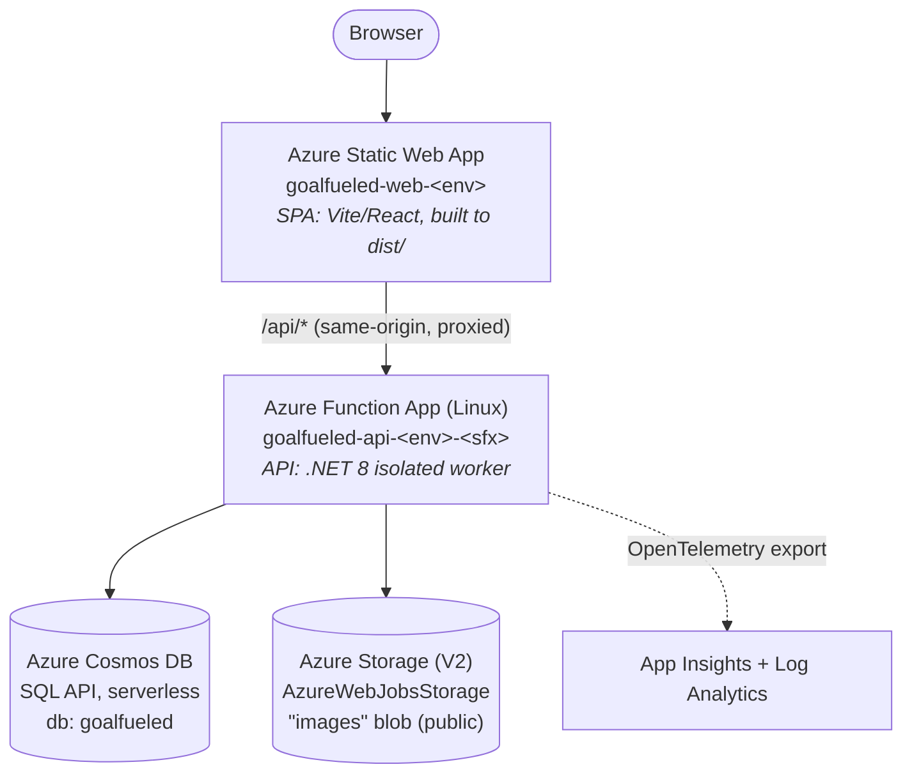

# Deploying GoalFueled to Azure

This document describes the end-to-end steps to deploy the GoalFueled app to Azure, based on
the Bicep infrastructure and CI/CD workflows already authored in this repo. It is meant to be
followed top to bottom by a developer with an Azure subscription.

> For local development setup, see [`README.md`](README.md). This document covers cloud deployment
> only and does not duplicate the local-run instructions.

---

## 1. Overview / architecture

GoalFueled deploys as a small, serverless Azure topology:



Provisioned resources (all defined under `infra/`):

| Resource | Bicep module | Notes |
|----------|--------------|-------|
| Log Analytics workspace | `infra/modules/monitoring.bicep` | `goalfueled-log-<env>`, 30-day retention |
| Application Insights | `infra/modules/monitoring.bicep` | `goalfueled-appi-<env>`, workspace-based |
| Storage account (StorageV2) | `infra/modules/storage.bicep` | Functions backend + public-read `images` container |
| Cosmos DB account (SQL API, serverless) | `infra/modules/cosmos.bicep` | DB `goalfueled`, partitioned by `/id`. The app auto-creates all containers at startup via EF `EnsureCreatedAsync` (`Program.cs`), so the module's container list is a convenience, not the source of truth |
| Function App + Flex Consumption plan (Linux, FC1) | `infra/modules/functionApp.bicep` | .NET 8 isolated runtime; deployment package staged from the storage `deployments` container; system-assigned managed identity, HTTPS-only |
| Static Web App (Free tier) | `infra/modules/staticWebApp.bicep` | Hosts the SPA; region pinned to `eastus2` |

The composition root is `infra/main.bicep` (`targetScope = 'resourceGroup'`).

### Resource naming

Names derive from two parameters — `namePrefix` (default `goalfueled`) and `environment`
(`dev` | `test` | `prod`) — plus a deterministic `uniqueString(...)` suffix used to keep globally
unique names collision-free:

- Function App: `goalfueled-api-<env>-<6-char-suffix>`
- App Service (Flex Consumption) plan: `goalfueled-plan-<env>-<6-char-suffix>`
- Static Web App: `goalfueled-web-<env>`
- Cosmos account: `goalfueled-<env>-<6-char-suffix>` (lowercased)
- Storage account: `goalfueled<11-char-suffix>` (lowercase alphanumeric, ≤24 chars)
- App Insights / Log Analytics: `goalfueled-appi-<env>` / `goalfueled-log-<env>`

All resources lead with the `goalfueled` prefix (`<prefix>-<role>-<env>`); the role segment
(`api`, `plan`, `web`, `log`, `appi`) sits in the middle.

The actual generated names are emitted as deployment outputs (`functionAppName`,
`functionAppHostname`, `staticWebAppName`, `staticWebAppHostname`, `cosmosAccountName`) — capture
them, because the unique suffix is not predictable up front.

---

## 2. Prerequisites

Tooling (versions taken from the repo):

| Tool | Version | Why |
|------|---------|-----|
| Azure CLI | latest | Provisioning + manual deploys (`az`) |
| Bicep CLI | bundled with Azure CLI | Compiles `infra/*.bicep` |
| .NET SDK | **8.0.x** | `<TargetFramework>net8.0</TargetFramework>` in `src/GoalFueled.Api/GoalFueled.Api.csproj`; CI uses `8.0.x` |
| Azure Functions Core Tools | **v4** | `<AzureFunctionsVersion>V4</AzureFunctionsVersion>`; manual API publish via `func` |
| Node.js | **22.x** | CI (`ci.yml`, `azure-pipelines.yml`) uses node 22; Vite 7 builds the SPA |
| SWA CLI (`@azure/static-web-apps-cli`) | latest | Optional, for manual SPA deploys |

> There is no `global.json` in the repo, so the .NET SDK version is pinned only by the csproj
> target framework and the CI workflows (`8.0.x`).

Azure account requirements:

- An Azure subscription (`<YOUR_SUBSCRIPTION_ID>`).
- Permission to create a resource group and resources in it. For the resource-group-scoped
  deployment you need at least **Contributor** on the target resource group (or subscription).
- To wire up CI/CD and Key Vault hardening you additionally need **User Access Administrator** /
  **Owner** to create role assignments and a service principal.

Sign in and select the subscription:

```bash
az login
az account set --subscription <YOUR_SUBSCRIPTION_ID>
```

---

## 3. Provisioning the infrastructure

`infra/main.bicep` is **resource-group scoped** (`targetScope = 'resourceGroup'`), so create the
resource group first, then deploy with `az deployment group create`.

```bash
# 1. Create the resource group. Resources default to the group's region (override with
#    -p location=<region>), so pick the region here. Use eastus2 to co-locate with the
#    region-pinned Static Web App.
az group create -n goalfueled-rg-dev -l eastus2

# 2. (Recommended) Preview the changes.
az deployment group what-if \
  -g goalfueled-rg-dev \
  -f infra/main.bicep \
  -p infra/main.parameters.json \
  -p environment=dev

# 3. Deploy.
az deployment group create \
  -g goalfueled-rg-dev \
  -f infra/main.bicep \
  -p infra/main.parameters.json \
  -p environment=dev
```

Parameters (`infra/main.parameters.json` + overridable on the command line):

| Param | Default | Allowed |
|-------|---------|---------|
| `namePrefix` | `goalfueled` | any short prefix |
| `environment` | `dev` | `dev` \| `test` \| `prod` |
| `location` | `resourceGroup().location` (inherits the resource group region) | any region (Static Web App is hard-pinned to `eastus2` inside the module) |

Capture the outputs (you will need the Function App and Static Web App names below):

```bash
az deployment group show -g goalfueled-rg-dev -n main \
  --query properties.outputs
```

What this creates: Cosmos DB account + `goalfueled` database + the five containers, the storage
account + `images` blob container, the Function App + its Consumption plan with all app settings
pre-populated, the Static Web App, and App Insights + Log Analytics. The Function App is created
with the production app settings baked in by `functionApp.bicep` (see next section).

---

## 4. Configuration / app settings

The API resolves its data store and auth mode from configuration keys read in
`src/GoalFueled.Data/DataServiceCollectionExtensions.cs` and `src/GoalFueled.Api/Program.cs`. In
Azure these become **Function App application settings**. The Bicep already sets them
(`infra/modules/functionApp.bicep`); the table below is what each must be in production.

> Azure app settings use double underscores (`__`) for nested keys; the local
> `local.settings.json` uses colons (`:`). They map to the same `GoalFueled:...` config keys.

| App setting (Azure) | Production value | Purpose / source |
|---------------------|------------------|------------------|
| `GoalFueled__UseInMemoryStore` | `false` | Forces the Cosmos provider (not the ephemeral in-memory store). Read in `DataServiceCollectionExtensions.cs`. |
| `GoalFueled__Cosmos__Database` | `goalfueled` | Cosmos database name. |
| `GoalFueled__Cosmos__ConnectionString` | *(Cosmos connection string)* | Cosmos SQL-API connection string. Currently injected inline from `cosmos.outputs.connectionString`. |
| `GoalFueled__Auth__EnableDevAuth` | `false` | Disables the dev `X-Dev-*` header login. **Must be `false` in any deployed env.** Read in `Program.cs` / `DevIdentityProvider`. |
| `GoalFueled__Auth__Entra__Authority` | *(Entra authority URL)* | Enables Entra External ID sign-in. Set via the `entraAuthority` Bicep param. See §9. |
| `GoalFueled__Auth__Entra__Audience` | *(API client id)* | Entra token audience. Set via the `entraAudience` Bicep param. See §9. |
| `AzureWebJobsStorage` | *(storage conn string)* | Functions runtime storage. |
| `DEPLOYMENT_STORAGE_CONNECTION_STRING` | *(storage conn string)* | Where Flex Consumption stages the deployment package (the `deployments` blob container). |
| `FUNCTIONS_WORKER_RUNTIME` | `dotnet-isolated` | .NET isolated worker. |
| `APPLICATIONINSIGHTS_CONNECTION_STRING` | *(App Insights conn string)* | Enables OpenTelemetry export (gated on this var in `Program.cs`). |

> Flex Consumption sets the runtime name/version and the run-from-package behavior through the
> Function App's `functionAppConfig` (see `functionApp.bicep`), so the classic
> `FUNCTIONS_EXTENSION_VERSION` and `WEBSITE_RUN_FROM_PACKAGE` settings are no longer used.

Optional setting (used if you enable automatic nutrition lookup, per `README.md`):

| App setting | Value | Purpose |
|-------------|-------|---------|
| `GoalFueled__Nutrition__FdcApiKey` | *(USDA FoodData Central key)* | Server-side nutrition enrichment. |

### CORS — auto-wired to the Static Web App

`infra/main.bicep` sets the Function App's allowed CORS origin to the Static Web App's own hostname
automatically, by passing `spaAllowedOrigins: [ 'https://${staticWebApp.outputs.defaultHostname}' ]`
to `functionApp.bicep` (which exposes the `spaAllowedOrigins` param). No manual post-deploy step is
needed.

In the deployed Static Web Apps topology the SPA actually calls the API as a same-origin `/api/*`
path (see `src/web/vite.config.ts` and `src/web/src/api/client.ts`, which fetch `` `/api${path}` ``),
so cross-origin CORS is normally not even exercised — the auto-wired origin just covers the case where
the Function App is called directly from the browser. To add more origins (e.g. a custom domain),
override the param or use the CLI:

```bash
az functionapp cors add -g goalfueled-rg-dev -n <FUNCTION_APP_NAME> \
  --allowed-origins https://<CUSTOM_DOMAIN>
```

### Frontend → API wiring

The SPA always calls `` /api${path} `` (`src/web/src/api/client.ts`). Two ways to satisfy this in
Azure:

- **Static Web Apps linked backend** (recommended): link the Function App to the Static Web App so
  `/api/*` is proxied to the Function App from the same origin. `src/web/public/staticwebapp.config.json`
  already routes `/api/*` with `allowedRoles: ["anonymous"]` and sets the SPA navigation fallback.
- Otherwise, front the API at the same origin via your own reverse proxy.

---

## 5. Secrets management

**Current state (note for hardening):** `infra/modules/functionApp.bicep` injects the Cosmos and
storage connection strings **inline** as app settings (the Cosmos string flows through a `@secure()`
param, and the storage key is read via `listKeys()`). This works but leaves secrets visible in the
Function App configuration and deployment history.

**Recommended hardening:**

1. Provision an Azure Key Vault and store the Cosmos connection string (and any nutrition API key)
   as secrets.
2. The Function App already has a **system-assigned managed identity** (`identity: { type:
   'SystemAssigned' }` in `functionApp.bicep`, output as `principalId`). Grant it `Key Vault Secrets
   User` on the vault.
3. Replace the inline app-setting values with Key Vault references, e.g.
   `@Microsoft.KeyVault(SecretUri=https://<vault>.vault.azure.net/secrets/cosmos-connection)`.
4. Prefer Microsoft Entra (AAD) auth to Cosmos over connection-string keys where possible — the
   Cosmos module sets `disableLocalAuth: false` today; a hardened setup would assign the Function
   App's identity the Cosmos data-plane role and disable local auth.

### Secrets/variables the CI/CD workflows expect

**GitHub Actions** (`.github/workflows/`):

| Workflow | Secrets | Variables |
|----------|---------|-----------|
| `deploy-dev.yml` (auto, env `dev`) | `AZURE_STATIC_WEB_APPS_API_TOKEN` (SWA deployment token) | `AZURE_CLIENT_ID`, `AZURE_TENANT_ID`, `AZURE_SUBSCRIPTION_ID` (OIDC login), `AZURE_FUNCTIONAPP_NAME`, `VITE_ENTRA_CLIENT_ID`, `VITE_ENTRA_AUTHORITY`, `VITE_ENTRA_API_SCOPE` |
| `deploy-prod.yml` (auto, env `prod`) | same as `deploy-dev.yml`, set on the `prod` Environment | same as `deploy-dev.yml`, set on the `prod` Environment |
| `deploy-infra.yml` | `AZURE_CREDENTIALS` (`az ad sp create-for-rbac --sdk-auth` output) | `AZURE_RESOURCE_GROUP`, `AZURE_LOCATION` |
| `deploy.yml` | `AZURE_FUNCTIONAPP_PUBLISH_PROFILE` (Function App publish profile XML), `AZURE_STATIC_WEB_APPS_API_TOKEN` (SWA deployment token) | `AZURE_FUNCTIONAPP_NAME` |
| `ci.yml` | *(none — build/test only)* | *(none)* |

> `deploy-dev.yml` uses **OIDC** (federated credentials), so it needs no stored Azure password/secret —
> create a federated credential on `AZURE_CLIENT_ID` that trusts this repo's `dev` environment
> (subject `repo:<owner>/<repo>:environment:dev`) and grant that identity Contributor on the resource group.

**Azure DevOps** (`azure-pipelines.yml`) — set these as pipeline variables / a variable group:

- `azureServiceConnection` — ARM service connection name
- `functionAppName` — name of the deployed Function App
- `staticWebAppToken` — SWA deployment token (referenced for the web deploy)

---

## 6. CI/CD deployment

Both a GitHub Actions setup and an Azure DevOps pipeline exist, and all of them are **inert until you
configure the secrets/variables above**. Once configured, `deploy-dev.yml` auto-deploys on every push
to `dev`; the other workflows remain manual (`workflow_dispatch`).

### GitHub Actions

Five workflows under `.github/workflows/`:

1. **`ci.yml` — CI (automatic).** Triggers on push/PR to `main` and `dev`. Builds + tests the
   .NET API (`dotnet restore/build/test GoalFueled.slnx`) and builds the React web app
   (`npm ci`, `npm run lint`, `npm run build`). No deployment.
2. **`deploy-dev.yml` — Deploy (dev) (automatic).** Triggers on **push to `dev`** (also
   `workflow_dispatch`). A `build-test` job builds + tests the API and builds the SPA (baking in the
   `VITE_ENTRA_*` vars), uploading both as artifacts; `deploy-api` and `deploy-web` jobs then run only
   if it's green. Azure login uses **OIDC** (no stored publish profile); the SPA deploy uses the SWA
   token. Configure a `dev` GitHub Environment with the variables/secrets listed at the top of the
   workflow file. This is the auto-deploy pipeline for the dev environment.
3. **`deploy-prod.yml` — Deploy (prod) (automatic).** Identical in shape to `deploy-dev.yml` but
   triggers on **push to `main`** and targets a `prod` GitHub Environment. Add required reviewers to
   the `prod` Environment to gate production deploys behind a manual approval.
4. **`deploy-infra.yml` — Deploy Infrastructure (manual).** `workflow_dispatch` with an
   `environment` input (`dev`/`test`/`prod`). Logs in with `AZURE_CREDENTIALS`, ensures the resource
   group, runs `az deployment group what-if`, then `az deployment group create` against
   `infra/main.bicep`.
5. **`deploy.yml` — Deploy (manual).** `workflow_dispatch`. The environment-agnostic manual fallback
   (publish-profile based). Two jobs:
   - `deploy-api`: `dotnet publish src/GoalFueled.Api/GoalFueled.Api.csproj -c Release -o ./publish`
     then `Azure/functions-action@v1` using the publish profile.
   - `deploy-web`: `Azure/static-web-apps-deploy@v1` with `app_location: src/web`,
     `output_location: dist`.

**Order of operations (GitHub Actions):**

1. Configure repo **secrets**: `AZURE_CREDENTIALS`, `AZURE_FUNCTIONAPP_PUBLISH_PROFILE`,
   `AZURE_STATIC_WEB_APPS_API_TOKEN`. Configure repo **variables**: `AZURE_RESOURCE_GROUP`,
   `AZURE_LOCATION`, `AZURE_FUNCTIONAPP_NAME`.
2. Run **Deploy Infrastructure** (`deploy-infra.yml`), choosing the environment. This provisions
   everything in §3 and lets you read the Function App / SWA names from the deployment outputs.
3. Grab the Function App **publish profile** and the Static Web App **deployment token** from the
   provisioned resources and set them as the secrets in step 1.
4. Run **Deploy** (`deploy.yml`) to publish the API and the SPA.
5. Apply the production config (§4) if not already baked in, and tighten CORS.

### Azure DevOps

`azure-pipelines.yml`:

- **Triggers** on push/PR to `main` and `dev`.
- **Build stage** (always): builds + tests the API, publishes the API as the `api` pipeline
  artifact, builds the web and publishes `src/web/dist` as the `web` artifact.
- **Deploy stage** (gated): runs only on `main`
  (`eq(variables['Build.SourceBranch'], 'refs/heads/main')`). The `deployApi` deployment job
  downloads the `api` artifact and deploys it with `AzureFunctionApp@2` using
  `$(azureServiceConnection)` and `$(functionAppName)`.

> The Deploy stage as authored deploys **only the API**. The web artifact is built and published but
> there is no SWA deploy step in the pipeline yet (see Gaps). Deploy the SPA via GitHub Actions or
> manually (§7).

To enable: create the ARM service connection, set `azureServiceConnection`, `functionAppName`,
`staticWebAppToken`, then push to `main`.

---

## 7. Manual deployment (fallback)

Use these if you are deploying without CI/CD. Substitute the real names from the deployment outputs.

### API (Azure Functions)

```bash
# Option A — Functions Core Tools (publishes the built output directly).
dotnet publish src/GoalFueled.Api/GoalFueled.Api.csproj -c Release -o ./publish
cd publish
func azure functionapp publish <FUNCTION_APP_NAME>

# Option B — zip deploy via az.
dotnet publish src/GoalFueled.Api/GoalFueled.Api.csproj -c Release -o ./publish
cd publish && zip -r ../api.zip . && cd ..
az functionapp deployment source config-zip \
  -g goalfueled-rg-dev -n <FUNCTION_APP_NAME> --src api.zip
```

### SPA (Static Web App)

```bash
# Build the SPA.
cd src/web
npm ci
npm run build          # tsc -b && vite build → src/web/dist

# Deploy with the SWA CLI using the deployment token.
swa deploy ./dist \
  --deployment-token <AZURE_STATIC_WEB_APPS_API_TOKEN> \
  --env production
```

The deployment token comes from the Static Web App (`az staticwebapp secrets list -g
goalfueled-rg-dev -n <STATIC_WEB_APP_NAME> --query properties.apiKey -o tsv`). Make sure
`src/web/public/staticwebapp.config.json` ships with the build (it does — Vite copies `public/` into
`dist/`).

---

## 8. Post-deployment verification

1. **API health probe** — there is an anonymous liveness endpoint
   (`src/GoalFueled.Api/Functions/HealthFunctions.cs`, route `health`):

   ```bash
   curl https://<FUNCTION_APP_HOSTNAME>/api/health
   # expect: {"status":"ok","service":"goalfueled-api"}
   ```

2. **SPA loads and reaches the API** — open `https://<STATIC_WEB_APP_HOSTNAME>` in a browser, confirm
   the app renders, and confirm network calls to `/api/*` return 200s (the client always calls
   `/api...`). If `/api` 404s, the SWA → Function App backend link is missing.

3. **Cosmos is in use (not the in-memory store)** — confirm `GoalFueled__UseInMemoryStore=false` on
   the Function App and that data persists across restarts. In the Function App log stream / App
   Insights you should see `Database initialized.` (from `Program.cs`) and **not** the
   "Database initialization failed... Set GoalFueled:UseInMemoryStore=true" error.

   ```bash
   az functionapp config appsettings list -g goalfueled-rg-dev -n <FUNCTION_APP_NAME> \
     --query "[?name=='GoalFueled__UseInMemoryStore'].value" -o tsv   # → false
   ```

   Also confirm the `goalfueled` database and its five containers exist in the Cosmos account.

4. **Dev auth is OFF** — confirm `GoalFueled__Auth__EnableDevAuth=false`. With dev auth off, the
   `X-Dev-*` headers no longer authenticate anyone (the only auth path until real auth is wired).

   ```bash
   az functionapp config appsettings list -g goalfueled-rg-dev -n <FUNCTION_APP_NAME> \
     --query "[?name=='GoalFueled__Auth__EnableDevAuth'].value" -o tsv  # → false
   ```

5. **Telemetry** — confirm requests appear in Application Insights (`goalfueled-appi-<env>`).

---

## 9. Authentication (Entra External ID — Google + email/password)

Sign-in is implemented end to end via **Microsoft Entra External ID**, which federates Google and
(when enabled) email+password local accounts. The pieces:

- **API** — `src/GoalFueled.Api/Auth/EntraExternalIdProvider.cs` validates the incoming Bearer JWT
  against the tenant's published OpenID metadata (issuer, audience, signing keys, lifetime) and maps
  `sub`/`email`/`name`/`picture` to the user. It is registered in `Program.cs` and stays inert until
  `GoalFueled:Auth:Entra:Authority` and `:Audience` are set, so it fails closed.
- **SPA** — runs in `entra` mode when the `VITE_ENTRA_*` vars are set at build time (see
  `src/web/.env.example` and `src/web/src/auth/authConfig.ts`); the login screen opens the Entra user
  flow via MSAL and sends `Authorization: Bearer <token>` on every API call.

> **Local development still uses the preset dev logins** (`X-Dev-*` headers via `DevIdentityProvider`,
> gated by `GoalFueled:Auth:EnableDevAuth=true`). When the `VITE_ENTRA_*` vars are unset, the SPA
> automatically falls back to the dev-user picker — so `npm run dev` needs no Entra setup. Dev auth is
> spoofable and **must stay off in deployed environments** (`GoalFueled__Auth__EnableDevAuth=false`).

### 9.1 Creating multiple test logins without multiple Google accounts

Enable the **Email with password** (local account) identity provider in the tenant's sign-up/sign-in
user flow, alongside Google. You can then self-register as many test users as you like with any email
address — no Google accounts required. The API treats every token from the tenant the same way (it is
`sub`-based and provider-agnostic), so Google and email/password accounts both just work. The first
account to sign in becomes the App Admin (`Authenticator.ResolveSignedInUserAsync`).

### 9.2 One-time tenant + app registration setup

1. **Create an Entra External ID tenant** (Azure portal → *Microsoft Entra External ID* → create an
   external (CIAM) tenant). Note its **tenant subdomain** and **tenant id**.
2. **Add identity providers** to the tenant: Google (configure a Google OAuth client and paste its
   client id/secret), and **Email with password** for password-based test logins.
3. **Create a sign-up/sign-in user flow** and associate both identity providers with it.
4. **Register the API app** (App registrations → New). Under *Expose an API*, set the Application ID
   URI (e.g. `api://<api-client-id>`) and add a scope, e.g. `access_as_user`.
5. **Register the SPA app**. Add a **Single-page application** redirect URI of the Static Web App
   origin (e.g. `https://goalfueled-web-dev.azurestaticapps.net`) plus `http://localhost:5173` for
   local testing. Under *API permissions*, add and grant the API scope from step 4.
6. Collect the values for the settings below.

### 9.3 Wiring the config

**API (Function App application settings)** — set via the `entraAuthority` / `entraAudience` Bicep
params or directly:

| App setting | Example |
|-------------|---------|
| `GoalFueled__Auth__Entra__Authority` | `https://<tenant>.ciamlogin.com/<tenant-guid>/v2.0` |
| `GoalFueled__Auth__Entra__Audience`  | `<api-client-id>` (or `api://<api-client-id>`) |

```bash
az functionapp config appsettings set -g goalfueled-rg-dev -n <FUNCTION_APP_NAME> --settings \
  GoalFueled__Auth__Entra__Authority="https://<tenant>.ciamlogin.com/<tenant-guid>/v2.0" \
  GoalFueled__Auth__Entra__Audience="<api-client-id>"
```

**SPA (build-time `VITE_ENTRA_*`)** — set as GitHub Environment *variables* (the `deploy-dev.yml`
workflow bakes them into the build) or in a local `.env.local`:

| Var | Example |
|-----|---------|
| `VITE_ENTRA_CLIENT_ID`   | `<spa-client-id>` |
| `VITE_ENTRA_AUTHORITY`   | `https://<tenant>.ciamlogin.com/<tenant-guid>/v2.0` |
| `VITE_ENTRA_API_SCOPE`   | `api://<api-client-id>/access_as_user` |

These are not secrets (the SPA is a public client) and are safe to expose in the bundle.

---

## 10. Rollback / teardown

**Rollback:**

- **API** — redeploy the previous build/artifact. With CI/CD, re-run `deploy.yml` (GitHub) or the
  Deploy stage (DevOps) from a known-good commit/artifact; or `func azure functionapp publish` the
  previous package. Because `WEBSITE_RUN_FROM_PACKAGE=1` is used, you can also swap the deployed
  package back.
- **SPA** — redeploy the previous `dist` via `swa deploy` or the GitHub `deploy-web` job. Static Web
  Apps also supports staging/preview environments (`stagingEnvironmentPolicy: 'Enabled'`) for
  validating before promotion.
- **Infrastructure** — re-run `az deployment group create` with the prior Bicep revision;
  `what-if` first to preview the delta.

**Teardown (test environments):**

```bash
# Deletes the entire resource group and everything in it. Irreversible.
az group delete -n goalfueled-rg-dev --yes --no-wait
```

> Cosmos is serverless (pay-per-request) and the Static Web App is Free tier, so an idle dev
> environment is inexpensive — but delete it when done to avoid storage/Cosmos charges.

---

## 11. Custom domain (Azure DNS)

The live deployment serves the SPA from `goalfueled.com`. DNS is hosted in an **Azure DNS zone**
(`goalfueled.com`, in `goalfueled-rg-dev`); delegate the domain at the registrar to the zone's four
`*.azure-dns.*` name servers (`az network dns zone show -g goalfueled-rg-dev -n goalfueled.com
--query nameServers`).

Records and Static Web App custom domains:

- **Apex `goalfueled.com`** — register with `az staticwebapp hostname set ... --hostname goalfueled.com
  --validation-method dns-txt-token`, then create a **TXT** record at `@` with the validation token and
  an **alias A** record at `@` targeting the Static Web App resource
  (`az network dns record-set a create -g goalfueled-rg-dev -z goalfueled.com -n @ --target-resource
  <swa-resource-id>`). SWA validates and provisions a free managed cert (apex can take 15–30 min).
- **`www.goalfueled.com`** — a **CNAME** to the SWA default hostname, registered with the default
  `cname-delegation` validation. It serves the app (SWA has no host-based `www`→apex 301 redirect; a true
  redirect would need Azure Front Door).

Because the SPA calls the API cross-origin (SWA Free, §4), each domain that serves the SPA must be in the
Function App **CORS** allow-list and in the Entra **SPA app registration redirect URIs**:

- CORS: `https://goalfueled.com`, `https://www.goalfueled.com` (set live and in `main.bicep`'s
  `spaAllowedOrigins`).
- Entra `goalfueled-spa` → Authentication → **Single-page application** redirect URIs (must be SPA-type,
  not Web — a Web-platform URI causes a token-endpoint 400 on cross-origin code redemption).

## 12. Operational gotchas (learned in this deployment)

- **Flex Consumption forbids `FUNCTIONS_WORKER_RUNTIME`** as an app setting (deploy fails BadRequest
  51021); the runtime lives in `functionAppConfig.runtime`. See `functionApp.bicep`.
- **Deploy the API with `func azure functionapp publish`** (or `Azure/functions-action`). The Flex plan
  rejects `az functionapp deployment source config-zip` ("Runtime is not supported") and `az functionapp
  deploy` (415).
- **`az functionapp config appsettings set` fails on Flex** ("Runtime is not supported"); set app
  settings via the ARM REST API (`.../config/appsettings` list+PUT) instead. (`az functionapp cors` works.)
- **Cosmos containers: let EF Core create them.** Bicep must NOT pre-create them — EF's
  `HasPartitionKey(e => e.Id)` needs path `/Id` (capital), and a Bicep-created `/id` (lowercase) causes
  every write to fail (400 / substatus 1001). See `cosmos.bicep`.
- **SWA Free can't link a backend** (needs Standard), so the SPA calls the API cross-origin via
  `VITE_API_BASE_URL`; the Function App CORS must allow the SPA origin(s).

---

## Appendix — file reference

| Concern | File(s) |
|---------|---------|
| Infra composition | `infra/main.bicep`, `infra/main.parameters.json` |
| Infra modules | `infra/modules/{monitoring,storage,cosmos,functionApp,staticWebApp}.bicep` |
| Store selection / Cosmos binding | `src/GoalFueled.Data/DataServiceCollectionExtensions.cs` |
| Auth + telemetry wiring | `src/GoalFueled.Api/Program.cs` |
| Auth seam (production) | `src/GoalFueled.Api/Auth/EntraExternalIdProvider.cs` |
| Health probe | `src/GoalFueled.Api/Functions/HealthFunctions.cs` |
| Local-only settings | `src/GoalFueled.Api/local.settings.json` (not deployed) |
| SPA → API client | `src/web/src/api/client.ts`, `src/web/vite.config.ts` |
| SWA routing config | `src/web/public/staticwebapp.config.json` |
| CI / deploy workflows | `.github/workflows/{ci,deploy,deploy-infra}.yml`, `azure-pipelines.yml` |
